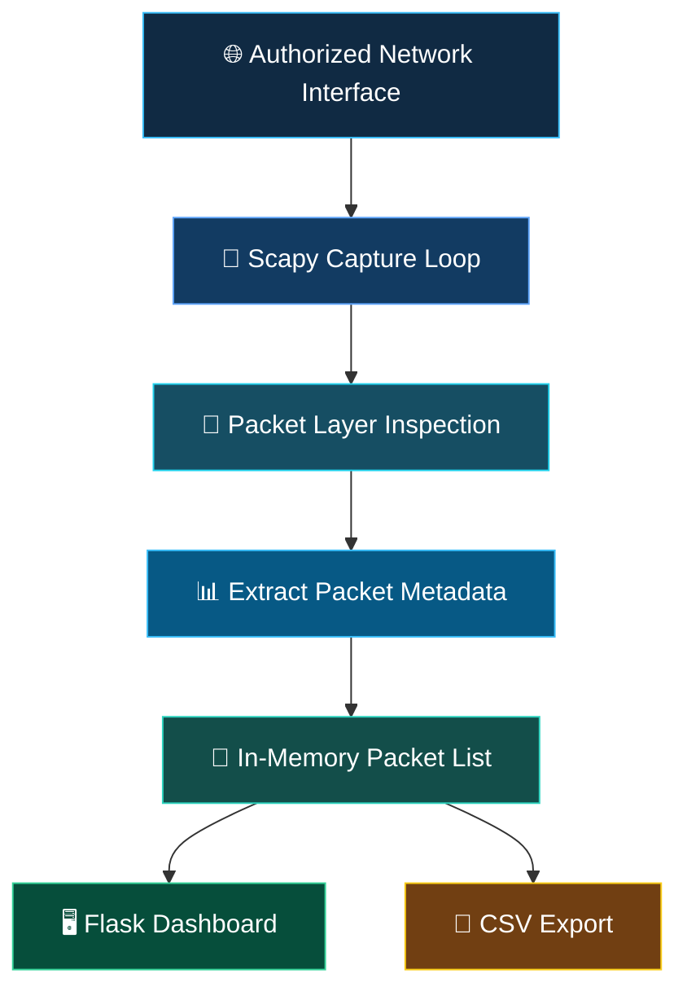

<div align="center">


<br>

<p>
  
  
  
  
</p>

**CAPTURE · INSPECT · ANALYZE · UNDERSTAND**

*A lightweight, browser-based network packet viewer built with Python, Scapy, and Flask.*

<br>

[Features](#-features) · [Architecture](#-how-it-works) · [Installation](#-getting-started) · [Testing](#-quick-test) · [Safety](#-scope--limitations)

</div>

---

## ◈ 01 — Project Overview

**NEUROTRACE** is a lightweight network packet analysis tool that captures packets visible to a selected network interface and presents useful packet metadata through a local web dashboard.

Built using **Python, Scapy, and Flask**, it provides a practical way to explore network communication, understand protocol layers, and inspect basic traffic information.

> **Internship:** CodeAlpha Cyber Security Internship
> **Assigned Task:** Task 1 — Basic Network Sniffer.

### 🎯 Project Objective

The objective is to make packet inspection easier to understand through a simple graphical interface rather than relying entirely on command-line packet analysis.

---

## ✦ 02 — Features

<div align="center">

| Capability              | Description                                                                                           |
| :---------------------- | :---------------------------------------------------------------------------------------------------- |
| 🟢 **Live Capture**     | Captures packets using Scapy on a selected or default interface.                                      |
| 🌐 **Packet Metadata**  | Displays timestamps, source/destination IPs, protocols, ports, lengths, and summaries when available. |
| 🔎 **BPF Filtering**    | Supports capture filters such as `tcp`, `udp`, and `icmp`.                                            |
| ⏯️ **Capture Controls** | Start, stop, and clear the in-memory packet list.                                                     |
| 📁 **CSV Export**       | Downloads captured metadata as `packetscope_capture.csv`.                                             |
| 🖥️ **Local Dashboard** | Provides a Flask interface at `127.0.0.1:5001`.                                                       |

</div>

### ✨ What makes it useful?

* Simple browser-based packet inspection.
* Real-time capture workflow.
* Useful network metadata in one place.
* Basic filtering for selected protocols.
* Exportable packet records for further analysis.

---

## 🧭 03 — How It Works

NEUROTRACE follows a simple packet-capture and processing workflow.



### Packet Processing Steps

| Step | Component           | Responsibility                                |
| :--: | ------------------- | --------------------------------------------- |
|  01  | Network Interface   | Provides visible network packets.             |
|  02  | Scapy               | Captures packets from the selected interface. |
|  03  | Packet Inspection   | Identifies supported packet layers.           |
|  04  | Metadata Extraction | Extracts available packet information.        |
|  05  | Flask Dashboard     | Displays captured packet records.             |
|  06  | CSV Export          | Exports packet metadata for later analysis.   |

### Supported Packet Information

* IPv4 and IPv6.
* TCP and UDP.
* ICMP.
* DNS.
* Source and destination addresses.
* Ports, packet length, timestamp, and summary when available.

---

## 🖥️ 04 — Getting Started

### Requirements

* Python 3.10 or newer recommended.
* Windows, Linux, or macOS.
* Scapy and Flask dependencies.
* Windows users: Npcap installed.
* Linux/macOS users: appropriate packet-capture permissions and libpcap support may be required.

### Windows Installation

**Step 1 — Clone the repository**

```powershell
git clone https://github.com/Prince-0j1/NeuroTrace.git
cd NeuroTrace
```

**Step 2 — Create a virtual environment**

```powershell
py -m venv .venv
.\.venv\Scripts\Activate.ps1
```

**Step 3 — Install dependencies**

```powershell
python -m pip install --upgrade pip
pip install -r requirements.txt
```

**Step 4 — Start the application**

```powershell
python app.py
```

Alternatively, double-click `run_windows.bat`.

### Linux / macOS Installation

```bash
git clone https://github.com/Prince-0j1/NeuroTrace.git
cd NeuroTrace

python3 -m venv .venv
source .venv/bin/activate

python -m pip install --upgrade pip
pip install -r requirements.txt

python app.py
```

Alternatively, use the included helper:

```bash
chmod +x run_linux_mac.sh
./run_linux_mac.sh
```

### 🌐 Access the Dashboard

Once the application starts, open:

```text
http://127.0.0.1:5001
```

---

## 🧪 05 — Quick Test

Follow these steps to verify the basic packet-capture workflow.

**Step 1:** Start NEUROTRACE and open the dashboard.

**Step 2:** Leave the interface and BPF filter fields blank for the initial test.

**Step 3:** Start packet capture.

**Step 4:** Generate ordinary network traffic in another terminal:

```bash
ping 1.1.1.1
```

You can also browse to a website to generate network traffic.

**Step 5:** Confirm that packet records appear in the dashboard.

**Step 6:** Stop capture and export the records as CSV.

**Step 7:** Try a BPF filter:

```text
icmp
```

Generate another ping and check whether matching packets appear.

### Expected Result

Captured packet metadata should appear in the dashboard table, and the CSV export should contain the available packet records.

> **Troubleshooting:** A quiet interface, incorrect interface selection, missing permissions, firewall/network restrictions, or a restrictive filter can result in no visible packets.

---

## 📁 06 — Project Structure

```text
NeuroTrace/
│
├── app.py
│   └── Flask routes and Scapy capture worker
│
├── requirements.txt
│   └── Flask and Scapy dependencies
│
├── run_windows.bat
│   └── Windows setup and launch helper
│
├── run_linux_mac.sh
│   └── Linux/macOS setup and launch helper
│
└── templates/
    ├── base.html
    │   └── Shared dashboard layout and styling
    │
    └── index.html
        └── Capture controls and packet table
```

---

## ⚙️ 07 — Configuration Notes

| Setting           | Details                                                   |
| ----------------- | --------------------------------------------------------- |
| Default URL       | `http://127.0.0.1:5001`                                   |
| Network Interface | Can be left blank to use Scapy's default interface.       |
| BPF Filters       | Applied during packet capture.                            |
| Packet Storage    | Records are held in memory while the application runs.    |
| CSV Export        | Export important results before stopping the application. |

**Important:** Invalid BPF filters can prevent packet capture from starting.

---

## ⚠️ 08 — Scope & Limitations

NEUROTRACE is a learning-oriented packet metadata viewer, not a full protocol dissector or digital forensics suite.

* HTTPS/TLS application data remains encrypted. This tool does not decrypt it or reveal passwords.
* Capture visibility depends on the selected interface, operating system, permissions, network topology, and adapter capabilities.
* It does not automatically see every device's traffic on a switched network.
* Packet capture may expose sensitive information.
* Captured records are held in memory and should be exported before stopping the application.

### 🔐 Responsible Use

Use NEUROTRACE only on networks and devices you own or are explicitly authorized to inspect.

---

## 🎓 09 — Learning Outcomes

This project helped explore:

* Network packet capture.
* Protocol identification.
* IPv4 and IPv6 addressing.
* TCP and UDP communication.
* Network ports and packet metadata.
* BPF capture filters.
* Python-based network analysis.
* Flask dashboard development.

---

## 👨‍💻 Developer

<div align="center">

### PRINCE KOTADIYA

**Cyber Security Student | Python Developer**

Built as part of the **CodeAlpha Cyber Security Internship**.

<br>

**NEUROTRACE**

*See beyond the packets.*

<sub>CAPTURE · INSPECT · ANALYZE · UNDERSTAND</sub>

</div>

---

<div align="center">


</div>
